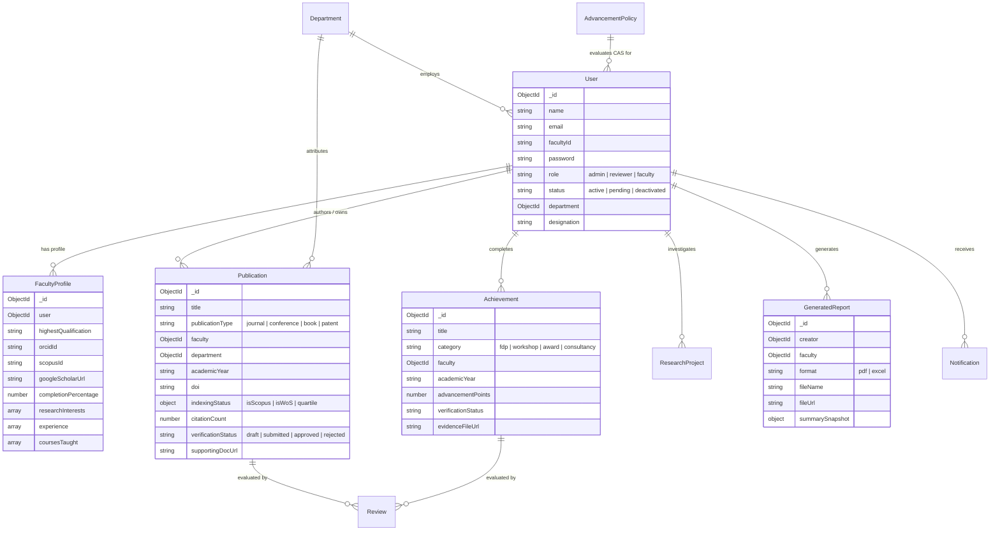

# Faculty Career Advancement & Publication Summary Generator

> **Enterprise Academic SaaS Platform for Higher Education Institutions & Universities**  
> Streamline faculty career advancement (CAS), peer-reviewed research tracking, bibliometric analytics, and automated dossier report generation (PDF & Excel).

---

## 🏛️ System Overview

The **Faculty Career Advancement & Publication Summary Generator** is a production-grade, full-stack MERN application engineered specifically for engineering colleges and universities. It centralizes research tracking, automates Career Advancement Scheme (CAS) appraisal metrics according to UGC/AICTE frameworks, provides peer-review scrutiny workflows for Department Heads (HODs), and automatically generates certified academic dossiers in both downloadable PDF and Excel formats.

---

## 🚀 Key Features

### 1. Robust Authentication & Role-Based Access Control (RBAC)
- **Three Core Institutional Roles:**
  - **Admin (Dean/Director):** Full governance over user accounts, department assignments, promotion scoring policies, and immutable system audit logs.
  - **Reviewer (Head of Department / HOD):** Departmental scrutiny queue to verify submitted publications, inspect evidence documents, and approve/reject/request corrections for CAS points.
  - **Faculty Member:** Manage academic profiles, submit publications & FDP achievements, track CAS promotion eligibility progress, and generate publication summaries.
- **Secure Sessions:** HTTP-only cookies, JWT verification with expiration, and bcrypt password hashing.
- **Self-Service Recovery:** Secure password reset workflow with single-use tokens.

### 2. Live Interactive Dashboard
- Real-time statistics calculated directly from MongoDB database records (never hardcoded).
- Displays total publications, Scopus journals, conference papers, patents, monographs, citations, and pending review counts.
- Dynamic bibliometric charts powered by Recharts (Yearly research output, Category distribution, Verification status, and Department comparisons).
- Academic session filters (`2024-2025`, `2023-2024`, etc.) and departmental scoping.

### 3. Faculty Profile & Academic ID Management
- Comprehensive academic profiles including Highest Qualification, Designation, Specialization, Courses Taught, and Professional Experience.
- Integration links for **ORCID iD**, **Scopus Author ID**, **Google Scholar**, **ResearchGate**, and **LinkedIn**.
- Dynamic profile completion percentage algorithm.
- Direct profile photo upload with live preview and audit history tracking.

### 4. Publication Lifecycle & Scholarly Metadata Verification
- Supports **Journal Articles**, **Conference Papers**, **Authored Books**, **Book Chapters**, **Patents**, and **Review Papers**.
- **External Metadata Lookup via Crossref API:** Input a DOI to automatically pull verified titles, journal venues, publishers, and publication dates.
- **Pre-submission Duplicate Detection:** Real-time checking to flag duplicate DOIs or similar titles before submission.
- Multi-author contribution management defining corresponding author flags and individual researcher roles.
- Supporting evidence attachment upload (PDF reprints / acceptance letters).
- Full state machine: `Draft` ➔ `Submitted` ➔ `Under Review` ➔ `Approved` / `Needs Correction` / `Rejected`.

### 5. Career Advancement Scheme (CAS) & Achievement Tracking
- Tracks 11+ professional categories including **Faculty Development Programs (FDPs)**, **Workshops**, **Conferences Attended**, **NPTEL Certifications**, **Invited Talks**, **Awards**, and **Consultancies**.
- **Institutional CAS Policy Engine:** Configurable promotion stages (e.g. Stage 1 to 2 / Assistant Professor Senior Scale) with minimum required points and mandatory journal thresholds.
- Real-time progress bars indicating earned points vs. requirements, with explicit provisional eligibility notices.

### 6. Automatic Publication Summary Generator (Core Engine)
- Filter by target faculty, academic year, department, and selected publication categories.
- Toggles to include/exclude achievements and CAS progression evaluations.
- **Live Interactive Preview:** Immediate render of the formal institutional summary with metric badges, publication tables, and scrutiny remarks.
- **Downloadable PDF Dossier:** Generated via PDFKit with institutional branding, credentials boxes, year-wise publication tables, indexing badges, and formal evaluation footers.
- **Downloadable Excel Workbook:** Multi-sheet workbook (`Executive Summary`, `Publications`, `Achievements & FDPs`, `Sponsored Projects`) created with ExcelJS with navy blue styling.
- Permanent report archiving with metadata snapshots.

### 7. Administrative Control & Compliance
- **User Management:** Filter by role and status, activate/deactivate accounts, and adjust designations.
- **Department Management:** Create departments, assign HODs, and track departmental research output.
- **CAS Policy Rule Editor:** Custom point caps, minimum journal quotas, and promotion stage parameters.
- **Security Audit Logs:** Complete audit trail tracking user logins, document reviews, privilege escalations, and report downloads.

---

## 🛠️ Technology Stack

| Domain | Technologies |
|---|---|
| **Frontend** | React 18, Vite, Tailwind CSS, Lucide React Icons, React Router v6, Recharts, Axios |
| **Backend** | Node.js (v20+), Express.js, RESTful Architecture (`/api/v1`) |
| **Database** | MongoDB with Mongoose ODM (with automatic in-memory fallback) |
| **Security** | Helmet, CORS, Rate-Limiting, HTTP-only Cookies, Bcrypt.js, Audit Logging |
| **Document Export** | PDFKit (PDF generation), ExcelJS (Multi-sheet workbooks) |
| **Storage & Uploads** | Multer with MIME validation and secure filesystem persistence |

---

## 📊 Database Relationship Architecture



---

## 💻 Installation & Local Setup

### Prerequisites
- **Node.js**: v18.0.0 or higher
- **npm**: v9.0.0 or higher
- *(Optional)* **MongoDB**: Local MongoDB community edition running on port `27017` or a MongoDB Atlas URI.  
  *Note:* If local MongoDB is not installed, the server automatically initializes **MongoMemoryServer** for seamless development!

---

### Step 1: Clone or Navigate to the Workspace
```powershell
cd "c:\Users\kisho\Desktop\fsd project"
```

---

### Step 2: Configure Environment Variables
Copy `.env.example` into `server/.env` (pre-configured):
```powershell
Copy-Item .env.example server\.env
```

Review `server/.env` settings:
```env
PORT=5000
NODE_ENV=development
MONGODB_URI=mongodb://127.0.0.1:27017/faculty_advancement
JWT_SECRET=faculty_career_advancement_jwt_secret_dev_2026
CLIENT_URL=http://localhost:5173
```

---

### Step 3: Start the Backend Server
In PowerShell, run:
```powershell
cd server
npm.cmd run dev
```
The server will connect to MongoDB (or launch MongoDB Memory Server) and automatically seed institutional demo data on first start.
- **Server API URL:** `http://localhost:5000/api/v1`
- **Health Check:** `http://localhost:5000/api/health`

---

### Step 4: Start the Frontend Client
In a separate terminal:
```powershell
cd client
npm.cmd run dev
```
- **Portal URL:** `http://localhost:5173`

---

## 👥 Pre-Seeded Development Demo Accounts

The database comes pre-populated with realistic fictional faculty members, verified publications, achievements, and CAS policies:

| Role | Email | Password | Access Scope |
|---|---|---|---|
| **System Admin** | `admin@institution.edu` | `Password@123` | Full administrative control, CAS rules, audit logs, all departments |
| **Reviewer (HOD)** | `hod.cse@institution.edu` | `Password@123` | Department of CSE scrutiny queue, approvals & verification |
| **Faculty 1** | `dr.sharma@institution.edu` | `Password@123` | Associate Professor, 4+ publications, CAS progress tracking |
| **Faculty 2** | `dr.ananya@institution.edu` | `Password@123` | Assistant Professor, conference papers & FDP records |

*(You can also register a new account on the `/register` page.)*

---

## 🧪 Automated Testing

The backend includes a test suite covering database connectivity, authentication, profile completion algorithm, publication CRUD, duplicate detection, review workflows, Crossref lookup, and CAS points calculation.

To run the backend tests:
```powershell
cd server
npm.cmd test
```

**Expected Result:**
```
======================================================
📊 Test Summary: 18 Passed, 0 Failed
======================================================
```

To run the frontend production build verification:
```powershell
cd client
npm.cmd run build
```

---

## 📄 Automated Report Generation Walkthrough

1. Sign in as `dr.sharma@institution.edu` (or `admin@institution.edu`).
2. Navigate to **Generate Summary** (`/generate-summary`) from the sidebar.
3. Select the academic session (e.g. `2024-2025` or `All Recorded Academic Years`).
4. Choose whether to include only approved publications or all records.
5. Click **Generate Live Preview** to inspect the metrics, tables, and CAS evaluation.
6. Click **Download PDF Report** to receive the formatted PDF document.
7. Click **Export Excel Workbook** to download the structured `.xlsx` workbook.
8. View previously compiled reports in **Report History** (`/reports/history`).

---

## 🔒 Security Best Practices Implemented

- **Password Hashing:** Passwords encrypted using `bcryptjs` with salt rounds.
- **HTTP-only Cookies & JWT:** Session tokens isolated from script access.
- **Input Sanitization:** Parameter validation across all endpoints.
- **Role Verification Middleware:** Backend route guarding ensures unauthorized users cannot modify data.
- **Audit Logging:** Sensitive actions logged with actor, entity, and timestamp.
- **Safe Fallback:** Zero exposure of secret keys, database credentials, or server stack traces in production responses.
